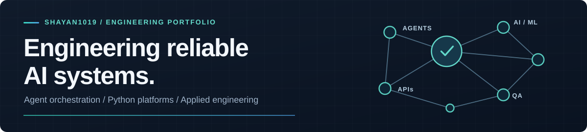

  

<h1 align="center">shayan1019</h1>

  <strong>AI Systems &amp; Software Engineer</strong> 
  Agentic AI · Python Backend · Full-Stack Engineering · Power Electronics

  <a href="mailto:shayan.r3@gmail.com">Email</a> ·
  <a href="https://github.com/shayan1019?tab=repositories">Repositories</a> ·
  <a href="https://github.com/shayan1019/engineering-os">Engineering OS</a> ·
  <a href="https://github.com/shayan1019/bigheroai-showcase">BigHeroAI</a>

---

I design and build software systems that connect **AI models, autonomous agents, backend services, user interfaces and real-world operations**. My work spans Python application engineering, multi-agent coordination, ML integration, API architecture, observability, security boundaries and automated validation.

I also bring **8+ years of hands-on power electronics and UPS engineering**, combining software problem-solving with practical experience in testing, diagnostics and systems reliability.

### Selected engineering projects

#### [Engineering OS (EOS)](https://github.com/shayan1019/engineering-os) — AI agent orchestration & engineering control plane
**Python · Rust · Agent Orchestration · Security · Automated QA**

- Built a project-aware control plane for AI-assisted development: deterministic task/skill routing, **nine bounded specialist roles**, permissions and evidence-backed quality gates.
- Implemented verification, artifact promotion, tamper checks, snapshot/rollback workflows and release validation. Designed to make agent actions traceable instead of relying only on prompts.
- **Status:** open-source alpha; core verification and supported-host integration are documented. Not represented as production-ready.

#### [BigHeroAI](https://github.com/shayan1019/bigheroai-showcase) — AI decision platform, trading infrastructure & observability
**Python · FastAPI · Pydantic · PyTorch · Flask · MQL5 · PostgreSQL · Docker · pytest**

- Architected a multi-component **Python/MT5 decision platform** with typed REST contracts, AI/ML inference (including a Temporal Fusion Transformer), multi-symbol market context, risk controls and modular order-execution boundaries.
- Developed decision, position-management and feedback flows with trade lifecycle tracing, reason codes and **decision-to-order execution lineage**; separated Python decision authority from broker-side MQL5 execution safeguards.
- Built **web/terminal observability dashboards** for operational health, decision traces, blockers and position lifecycles, using shared read-only data collection rather than duplicating business logic.
- Worked on account-aware server architecture, monitoring, persistent state, CI validation and extensive regression/replay testing. **Engineering and research project; no profitability or live-production claim.**

#### [ZipForge](https://github.com/shayan1019/zipforge) — cross-platform desktop software
**Rust · Tauri v2 · React · TypeScript · 7-Zip**

- Created an archive manager for Windows, Linux and macOS with file browsing, extraction/compression, encryption, progress and cancellation, Explorer integration and responsive handling of large archives.
- Implemented platform-specific packaging and release workflows, demonstrating engineering beyond the Python ecosystem.

#### [AURA](https://github.com/shayan1019/aura-showcase) — local-first AI coding agent
**Python · llama.cpp · GGUF · SQLite · Terminal UI · pytest**

- Developed a local coding-agent environment with **Ask / Plan / Build** workflows, streaming local model runtime, tool permissions, persistent sessions and memory, and automated tests.

### Additional projects

- **[RiskPulse](https://github.com/shayan1019/riskpulse-news-bot)** — asynchronous financial-news ingestion, normalization, classification, deduplication and multilingual Telegram alerts with reproducible replay tests.
- **[Infrastructure Automation](https://github.com/shayan1019/vpn-infrastructure-automation)** — Python-based remote Linux/service automation via SSH, systemd, provider APIs, health checks and controlled recovery/rollback.
- **[Static Regulator Engineering Calculator](https://github.com/shayan1019/static-regulator-engineering-showcase)** — Flask/Python desktop-packaged calculations for single-/three-phase regulator design, winding/taps, busbars and protection components.
- **[TradingView Indicators](https://github.com/shayan1019/tradingview-pine-indicators)** — Pine Script signal visualization, risk overlays, status panels and alerts.

### Technical focus

| Area | Technologies and practices |
| --- | --- |
| **AI & agentic systems** | LLM integration, local GGUF inference, tool execution, multi-agent routing, permission boundaries, replay and evaluation |
| **Backend & data** | Python, FastAPI, Flask, asyncio, Pydantic, REST APIs, PostgreSQL, SQLite, Redis |
| **Web & desktop** | HTML/CSS/JavaScript, React, TypeScript, Tauri, Rust, dashboards and operational UIs |
| **Reliability & delivery** | pytest, regression tests, API contracts, logs/tracing, GitHub Actions, Docker, Linux, SSH, recovery/rollback |
| **Industrial engineering** | UPS systems, power electronics, PCB fault diagnosis, oscilloscopes, load testing, calibration, FAT and root-cause analysis |

---

Some links are intentionally sanitized showcases. Proprietary trading logic, account data, credentials and private operational artifacts are not published. Project maturity and test evidence are documented in their respective repositories.
