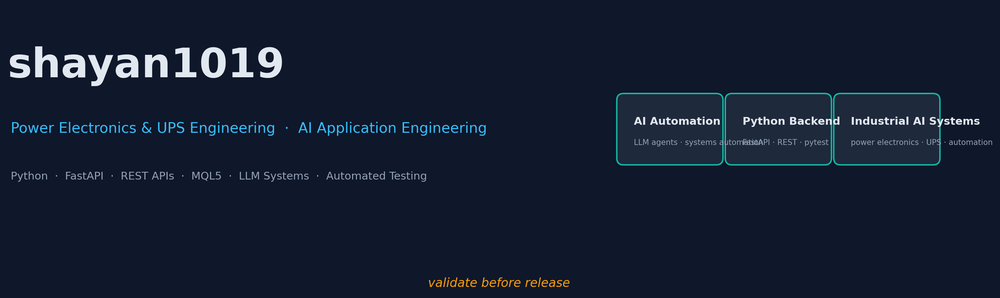

<h3 align="center">shayan1019</h3>
<h4 align="center">Power Electronics &amp; UPS Engineer | AI Application Engineer</h4>

  <a href="mailto:shayan.r3@gmail.com">Email</a>

---

**Two engineering tracks, one discipline: validate before release.**

### Power Electronics &amp; UPS Engineering
8+ years of hands-on employment at Delta UPS &amp; Regulators: production, assembly, component-level PCB repair and soldering/rework, static regulator and coil work, configuration, waveform/load/thermal/battery testing, calibration, FAT, root-cause analysis, and international remote support for 1–200&nbsp;kVA UPS systems.

### Independent AI, Agentic Systems &amp; Software Engineering
Python backend engineering, agentic AI, trading-system integration, and systems automation — outside the Delta role:

- **[BigHeroAI](https://github.com/shayan1019/bigheroai-showcase)** — AI decision system for MetaTrader 5: FastAPI backend with typed Pydantic v2 contracts, a companion Flask service serving a PyTorch Temporal Fusion Transformer model, a modular MQL5 Expert Advisor, and a pytest QA discipline (1,900+ automated tests). *Sanitized public showcase — private strategy internals excluded.*
- **[AURA](https://github.com/shayan1019/aura-showcase)** — a local-first coding-agent terminal built on llama.cpp/GGUF: Ask/Plan/Build modes, permission-gated tool execution, a persistent local daemon runtime with streaming, and session/memory state. *Sanitized public showcase — source stays private.*
- **[Static Regulator Engineering Calculator](https://github.com/shayan1019/static-regulator-engineering-showcase)** — a Flask-based engineering tool covering single/three-phase static regulator sizing (winding/tap, booster, busbar, ACB, SCR), packaged as a standalone Windows executable. *Sanitized public showcase — source and factory data stay private.*
- **[RiskPulse](https://github.com/shayan1019/riskpulse-news-bot)** — multilingual financial-news &amp; geopolitical risk Telegram bot: async multi-source ingestion (NewsAPI, GDELT, Marketaux, Alpha Vantage, Trading Economics), classification/prioritization/deduplication, persistent subscriber state, EN/TR/FA/AR delivery, deterministic replay testing.
- **TradingView / Pine Indicators** — rule-based ICT/SMC indicators: confirmed-bar BUY/SELL signals, entry/SL/TP visuals, status/risk panels, alerts. *Public showcase in progress — signal logic stays private.*
- **[Infrastructure Automation](https://github.com/shayan1019/vpn-infrastructure-automation)** — remote Linux service orchestration: SSH/Paramiko, systemd, config generation, provider APIs, Telegram workflows, health monitoring and operator-controlled recovery/rollback. Sanitized case study.

---

Public repositories here are sanitized showcases derived from larger private engineering work — architecture and engineering approach are documented, not production source, credentials, or proprietary strategy/parameter data.
